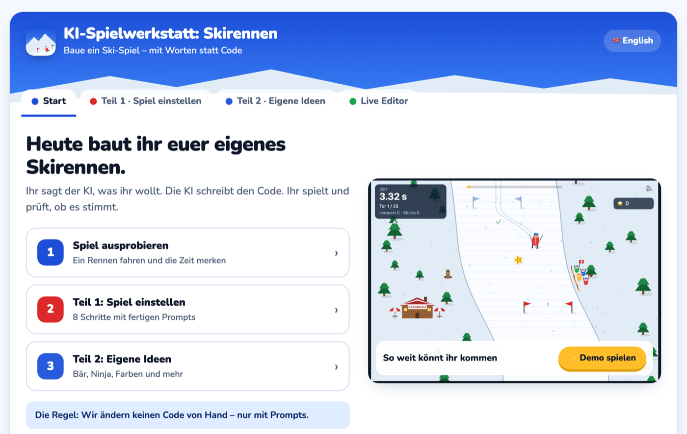
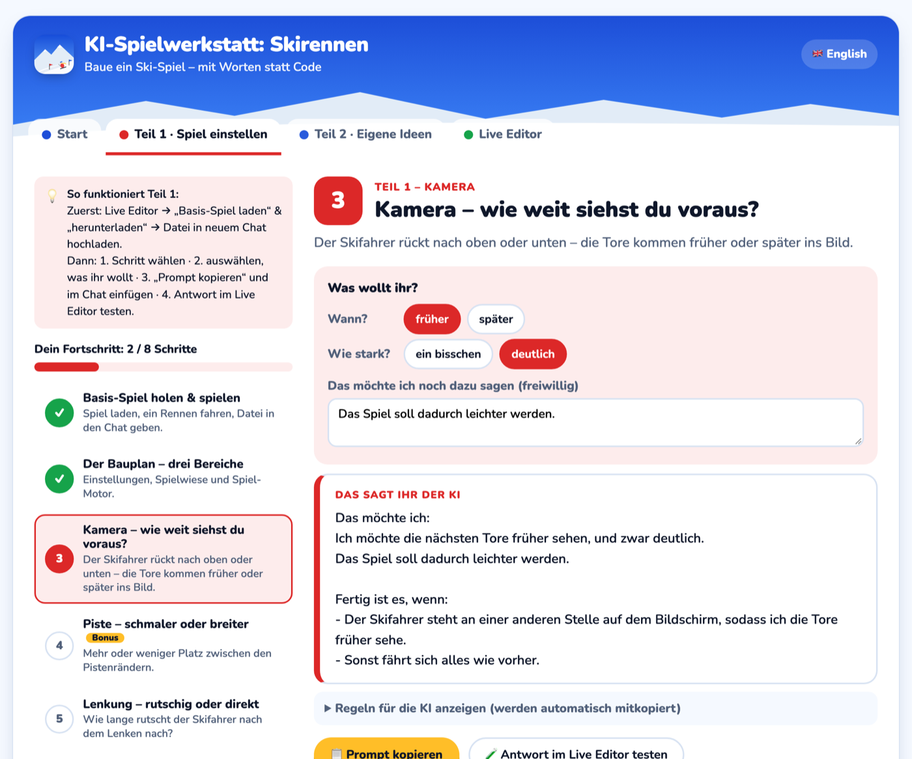
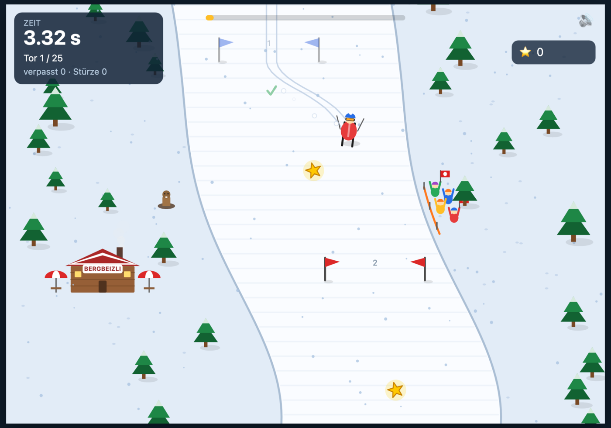

# ⛷ KI-Spielwerkstatt: Skirennen · AI Game Lab: Ski Race

**Deutsch** · [English](#english)

**Ein Ski-Spiel mit KI bauen – ohne eine Zeile Code selbst zu tippen.**
Ein fertiger Workshop, der das Programmieren mit KI näherbringt – für Teilnehmer:innen ab etwa 10 Jahren, in der Schule, im Ferienkurs, im Coding-Club oder am Zukunftstag. Auf Deutsch und Englisch.

**[▶ Workshop öffnen](https://rlen-source.github.io/skirennen/)** · **[✨ Demo spielen](https://rlen-source.github.io/skirennen/skirennen-v3.html)** · **[📄 Infoblatt (PDF)](https://rlen-source.github.io/skirennen/trainer-de.pdf)** · **[🇬🇧 English version](https://rlen-source.github.io/skirennen/en/)**

## Worum es geht

Die Teilnehmer:innen erleben, wie heute mit KI Software entsteht: Sie beschreiben, was ihr Spiel können soll, die KI schreibt den Code, und sie prüfen, ob das Ergebnis stimmt. Vorwissen braucht es keines – weder im Programmieren noch im Umgang mit KI.

Am Ende hat jedes Team sein eigenes Skirennen – mit eigener Strecke, eigener Spielfigur und eigenen Ideen. Und alle haben erlebt, dass die KI ein Werkzeug ist: Sie macht, was man ihr sagt, und manchmal auch Fehler, die man erkennen und beheben muss.

## Wo sich der Workshop eignet

Überall, wo ein erster, positiver Zugang zum Programmieren mit KI entstehen soll, zum Beispiel:

- **Schule:** im Informatik- oder Medienunterricht, in einer Projektwoche oder als Einstieg ins Thema KI
- **Ferienkurse und Coding-Clubs:** als halber Tag oder als Start für eine Reihe mit eigenen Spielideen
- **Zukunftstag und Firmenanlässe:** erleben, wie Software heute in Firmen entsteht. Hier ist der Workshop entstanden.
- **Bibliotheken, Jugendarbeit und Familienanlässe:** mit einem Laptop oder Tablet pro Team und einer erwachsenen Person, die den Chat bedient
- **Zu Hause:** Eltern und Kinder zusammen – alles läuft im Browser, und eine gespeicherte Version lässt sich später weiterbauen

Der Ablauf lässt sich anpassen: Teil 1 allein dauert etwa eine Stunde, Teil 2 und 3 lassen sich beliebig verlängern.

## Wie die Prompts funktionieren

Eine KI macht bei einer ungenauen Bitte jedes Mal etwas anderes. Ist ein Prompt dagegen zu technisch, versteht man nicht mehr, was man der KI eigentlich sagt. Der Workshop löst das so:

1. **Ein fertiges, stabiles Basis-Spiel als Start.** Niemand baut bei null an, alle verändern ein Spiel, das schon funktioniert.
2. **Ein Spiel mit drei klaren Bereichen:** Einstellungen, ein Bereich für eigene Ideen und ein Spiel-Motor, den niemand anfasst.
3. **Jeder Prompt hat zwei Teile:**
   - **Der eigene Satz:** Die Teilnehmer:innen wählen, was sie wollen („Die Tore sollen **früher** sichtbar sein, **deutlich**“), und ergänzen es frei. Das ist der Teil, den sie sehen und verstehen.
   - **Der Rahmen:** Regeln und Technik für die KI – wo sie arbeiten darf und was tabu ist. Er wird automatisch mitkopiert.
4. **Prüfen statt vorschreiben:** Nach jeder Antwort prüft der Launcher, ob der Spiel-Motor unverändert ist, und zeigt unter „Was hat sich geändert?“, ob die KI das Erwartete gemacht hat. Eine Checkliste „Fertig ist es, wenn …“ hilft beim Ausprobieren.
5. **🛟 Genauer Prompt als Rückfall:** Klappt es mit dem eigenen Satz nicht, gibt es bei jedem Schritt den Prompt mit allen Details, Wort für Wort.

Über den Tag nimmt die Hilfe ab: In **Teil 1** wird mit Auswahl-Knöpfen formuliert, in **Teil 2** mit mehr Freiheit, in **Teil 3** ganz frei mit der Formel *Ich möchte … · Nicht ändern … · Fertig ist es, wenn …*

Entstanden ist der Workshop für den Zukunftstag. Die erste Fassung (2025) arbeitete mit fertigen, Wort für Wort vorgegebenen Prompts, weil die Qualität des erzeugten Codes sonst nicht verlässlich war. Heute sichern Spiel-Aufbau und automatische Prüfung die Verlässlichkeit – darum dürfen die Teilnehmer:innen selbst formulieren.

## Was die Teilnehmer:innen lernen

- **Eine Absicht klar formulieren:** Ziel, Grenze und woran man merkt, dass es fertig ist.
- **Prüfen statt glauben:** Jedes Ergebnis wird gespielt und mit der Absicht verglichen. Hat die KI nur das Gewünschte verändert?
- **Computational Thinking:** Ein Spiel in Teile zerlegen (Piste, Tore, Bäume, Kamera), mit Zahlen steuern (Tempo, Reibung, Abstände), mit Ereignissen arbeiten („wenn ein Tor geschafft ist, dann …“).
- **Zufall mit Startwert:** Mit der gleichen Seed-Zahl fahren alle die gleiche, faire Strecke.
- **Fehler gehören dazu:** Wenn etwas kaputtgeht, gibt es einen Reparatur-Prompt – und man lernt, wie die KI Fehler macht.
- **Teamarbeit:** Ideen erklären, gemeinsam entscheiden, sich gegenseitig die Spiele zeigen.

## Ablaufvorschlag (ca. 3 Stunden)

| Zeit | Was passiert |
|---|---|
| 15 Min. | Begrüssung, Demo zeigen, Teams bilden (2–3 Personen pro Gerät) |
| 15 Min. | Basis-Spiel ausprobieren, Bestzeit merken, Datei im Chat hochladen |
| 70 Min. | **Teil 1:** Kamera, Lenkung, Regeln, eigene Strecke – Piste und Wald als Bonus |
| 15 Min. | Pause |
| 50 Min. | **Teil 2 und 3:** Schneefall, Deko, Gegner, Spielfigur, Farben – und eine ganz freie Idee |
| 15 Min. | Spiele gegenseitig ausprobieren, Bestzeiten vergleichen, kurze Runde: Was war überraschend? |

## So arbeiten die Teilnehmer:innen

Alles passiert auf einer Seite, dem **Launcher**. Er läuft am Laptop und auf dem iPad, ohne Installation.

1. **Spiel ausprobieren:** auf der Startseite „Spiel ausprobieren“ und ein Rennen fahren.
2. **Datei in den Chat:** im Live Editor „Basis-Spiel herunterladen“ und die Datei in einem neuen Chat hochladen.
3. **Schritt wählen und formulieren:** auswählen, was man will, und eigene Wünsche dazuschreiben. Daraus entsteht der eigene Satz.
4. **Prompt kopieren, Antwort testen:** im Chat einfügen, den Code aus der Antwort im Live Editor einfügen und „▶ Spiel anzeigen“. „Was hat sich geändert?“ und die Checkliste zeigen, ob es geklappt hat. Dann „✓ Klappt – nächster Schritt“.
5. **Teil 2 und 3:** eigene Ideen – vom Schneefall über einen Yeti, der einen jagt, bis zur ganz freien Idee.

### Wenn etwas klemmt

- **Die KI macht etwas anderes:** „🛟 Genauer Prompt“ unter dem Prompt aufklappen und diesen schicken.
- **Das Spiel hat einen Fehler:** Über dem Spiel erscheint ein roter Hinweis mit „Reparatur-Prompt kopieren“. Im Chat einfügen, neue Antwort testen.
- **Die Antwort hört mittendrin auf:** Der Launcher merkt das. Den Prompt „↻ Weiter“ schicken und „🧩 Fortsetzung anhängen“ benutzen.
- **Ein Schritt hat es schlechter gemacht:** „↩ Vorherige Version“ holt die letzte Version zurück.
- **Später weitermachen:** „💾 Meine Version herunterladen“ speichert das Spiel, „📂 Datei öffnen“ lädt es wieder – auch zu Hause.

## Die Demo

Die [Demo-Version](https://rlen-source.github.io/skirennen/skirennen-v3.html) zeigt zu Beginn, wie weit man kommen kann: Skihütten mit rauchendem Kamin, Bergziegen, Murmeltiere und Hasen, jubelndes Publikum, Sterne zum Sammeln, ein Bär, ein Adler und ein Feuerwerk im Ziel. Der Spiel-Motor ist genau derselbe wie im Basis-Spiel – alles Neue ist mit Prompts aus Teil 2 und 3 machbar.

## Vorbereitung für Trainer:innen

- [ ] **Chat-Zugang klären.** Gebraucht wird ein Chat mit KI, zum Beispiel ChatGPT oder Claude, in dem man Dateien hochladen kann. Die Anbieter haben Altersgrenzen. Bei jüngeren Teilnehmer:innen läuft der Chat deshalb meist über das Konto einer erwachsenen Person, die beim Team sitzt.
- [ ] **WLAN testen.** Der Launcher lädt von `rlen-source.github.io`, die Spiel-Bibliothek von `cdn.jsdelivr.net` und die Schrift von `fonts.googleapis.com`. Schul- und Firmen-WLANs blockieren manchmal einzelne davon – am besten vorher einmal auf einem Workshop-Gerät öffnen.
- [ ] **Einen Durchlauf selbst machen**, mindestens Teil 1 bis Schritt 3, mit dem Chat, den die Teilnehmer:innen benutzen.
- [ ] **Infoblatt ausdrucken** und aufhängen: [Deutsch (PDF)](https://rlen-source.github.io/skirennen/trainer-de.pdf) · [English (PDF)](https://rlen-source.github.io/skirennen/trainer-en.pdf). Der QR-Code führt direkt zum Launcher.
- [ ] **Trainer-Modus:** unten im Launcher „👩‍🏫 Trainer-Modus“ einschalten oder den Link mit `?trainer` öffnen. Dann erscheinen auf der Startseite Methode und Ablauf und in Teil 1 Lernziele und Gesprächsfragen zu jedem Schritt.

Gut zu wissen:

- Ein Schritt in Teil 1 zählt als erledigt, wenn im Live Editor „✓ Klappt“ gedrückt wird – nicht schon beim Kopieren.
- Jede Antwort der KI enthält das ganze Spiel (rund 36 000 Zeichen). Das ist Absicht: So gibt es nie halbe Dateien. In Gratis-Versionen der Chats werden lange Antworten aber manchmal abgeschnitten – dafür gibt es „↻ Weiter“.
- Die Prompts lassen sich im Code des Launchers in den Listen `promptsTeil1` und `promptsTeil2` anpassen (Feld `user` für den eigenen Satz, Feld `prompt` für den genauen Prompt).

## iPad und Tablet

- **Steuern:** Finger aufs Spielfeld legen und hin und her ziehen, der Skifahrer folgt. Am Laptop mit ← → oder A / D.
- **Als App:** in Safari **Teilen → Zum Home-Bildschirm**. Dann öffnet sich das Skirennen mit eigenem Symbol und ohne Adressleiste.
- **Dateien:** Beim Herunterladen öffnet sich das Teilen-Menü. Die Datei kann direkt an die ChatGPT- oder Claude-App gehen oder in „Dateien“ gesichert werden.
- Das Tablet am besten quer halten.

## Wie das Spiel gebaut ist

Das Spiel ist eine einzige HTML-Datei mit [p5.js](https://p5js.org). Es hat drei Bereiche:

1. **Einstellungen (`CONFIG`)** – alle Zahlen an einem Ort: Tempo, Anzahl Tore, Strafen, Pistenbreite, Seed
2. **Hier darfst du ändern** – Farben (`THEME`), Spielfigur (`drawPlayer`), Extras (`EXTRAS`) und Ereignisse (`onGatePassed`, `onCrash`, …)
3. **Spiel-Motor – nicht ändern** – Physik, Strecke, Kollisionen, Anzeige

Extras sind kleine Bausteine, die sich ins Spiel einklinken: Wenn ein Extra einen Fehler hat, schaltet der Spiel-Motor nur dieses Extra aus, und das Spiel läuft weiter.

**Getestet:** Alle Prompts wurden in simulierten Chats mit zwei KI-Modellen ausprobiert, mit verschiedenen Auswahl-Kombinationen und freien Zusätzen. Die KI hat jedes Mal die passende Stelle selbst gefunden, in die gewünschte Richtung geändert und den Spiel-Motor nicht angefasst; alle entstandenen Spiele laufen fehlerfrei.

## Was ist hier drin?

| Datei | Wofür |
|---|---|
| `index.html` | Der Launcher auf Deutsch – Startseite, Teil 1, Teil 2 und 3, Live Editor. Beide Spiele sind eingebaut. |
| `skirennen-v2.html` | Das Basis-Spiel |
| `skirennen-v3.html` | Die Demo-Version |
| `en/index.html`, `ski-race-v2.html`, `ski-race-v3.html` | Dasselbe auf Englisch |
| `trainer.html`, `trainer-de.pdf`, `trainer-en.pdf` | Infoblatt mit QR-Code |
| `docs/` | Bilder für diese Seite |

---

## English

**Build a ski game with AI – without typing a single line of code yourself.**
A ready-to-use workshop that introduces coding with AI – for participants from about 10 years, at school, in holiday courses, coding clubs or on Future Day ("Zukunftstag"). In German and English.

**[▶ Open the workshop](https://rlen-source.github.io/skirennen/en/)** · **[✨ Play the demo](https://rlen-source.github.io/skirennen/ski-race-v3.html)** · **[📄 Info sheet (PDF)](https://rlen-source.github.io/skirennen/trainer-en.pdf)**

Everything is available in English: the launcher, all prompts, the teaching notes and both games. With the English prompts the AI answers in English too.

### What it's about

Participants experience how software is made with AI today: they describe what their game should do, the AI writes the code, and they check whether the result is right. No prior knowledge is needed – neither of programming nor of AI.

By the end every team has its own ski race – with its own course, its own player figure and its own ideas. And everyone has seen that AI is a tool: it does what you tell it, and sometimes it makes mistakes you need to spot and fix.

### Where the workshop fits

Anywhere a first, positive experience of coding with AI is wanted, for example:

- **School:** in computer science or media lessons, during a project week, or as an introduction to AI
- **Holiday courses and coding clubs:** as a half day, or as the start of a series with the participants' own game ideas
- **Future Day and company events:** seeing how software is made in companies today. This is where the workshop started.
- **Libraries, youth work and family events:** with one laptop or tablet per team and an adult who handles the chat
- **At home:** parents and kids together – everything runs in the browser, and a saved version can be continued later

The plan is flexible: Part 1 alone takes about an hour, and Parts 2 and 3 can be extended as long as you like.

### How the prompts work

Given a vague request, an AI does something different every time. If a prompt is too technical, you no longer understand what you are telling the AI. The workshop solves this as follows:

1. **A finished, stable base game to start with.** Nobody builds from scratch; everyone changes a game that already works.
2. **A game with three clear areas:** settings, an area for your own ideas, and a game engine nobody touches.
3. **Every prompt has two parts:**
   - **Your own sentence:** participants choose what they want ("I want to see the gates **earlier**, **a lot**") and add to it freely. This is the part they see and understand.
   - **The frame:** rules and technical notes for the AI – where it may work and what is off limits. It is copied along automatically.
4. **Check instead of prescribe:** after every answer the launcher checks whether the game engine is unchanged and shows under "What has changed?" whether the AI did what was expected. A checklist "It is done when …" helps while trying it out.
5. **🛟 Exact prompt as a fallback:** if your own sentence doesn't work, every step has the prompt with all the details, word for word.

The help fades over the day: in **Part 1** participants phrase their wish with choice buttons, in **Part 2** with more freedom, in **Part 3** completely freely with the formula *I want … · Don't change … · It is done when …*

The workshop was created for Future Day. The first version (2025) used ready-made prompts written out word for word, because otherwise the generated code was not reliable. Today the game's structure and the automatic checks keep it reliable – so participants can phrase things themselves.

### What participants learn

- **State an intention clearly:** the goal, the limit, and how you can tell it is done.
- **Check instead of trust:** every result is played and compared with the intention. Did the AI change only what was wanted?
- **Computational thinking:** break a game into parts (piste, gates, trees, camera), control it with numbers (speed, friction, distances), work with events ("when a gate is passed, then …").
- **Randomness with a seed:** with the same seed number everybody gets the same, fair course.
- **Mistakes are part of it:** when something breaks there is a repair prompt – and you learn how AI makes mistakes.
- **Teamwork:** explain ideas, decide together, show each other the games.

### Suggested plan (about 3 hours)

| Time | What happens |
|---|---|
| 15 min | Welcome, show the demo, form teams (2–3 people per device) |
| 15 min | Try the base game, remember the best time, upload the file in the chat |
| 70 min | **Part 1:** camera, steering, rules, own course – piste and forest as bonus steps |
| 15 min | Break |
| 50 min | **Parts 2 and 3:** snowfall, decoration, a chaser, player figure, colours – and a completely free idea |
| 15 min | Try each other's games, compare best times, short round: what was surprising? |

### How participants work

Everything happens on one page, the **launcher**. It runs on laptops and iPads, with no installation.

1. **Try the game:** on the start page choose "Try the game" and do one race.
2. **File into the chat:** in the Live Editor press "Download base game" and upload the file in a new chat.
3. **Pick a step and phrase it:** choose what you want and add your own wishes. That becomes your own sentence.
4. **Copy the prompt, test the answer:** paste it in the chat, paste the code from the answer into the Live Editor and press "▶ Show game". "What has changed?" and the checklist show whether it worked. Then "✓ Works – next step".
5. **Parts 2 and 3:** your own ideas – from snowfall to a yeti chasing you to a completely free idea.

#### If something goes wrong

- **The AI does something else:** open "🛟 Exact prompt" below the prompt and send that one.
- **The game has an error:** a red notice appears above the game with "Copy repair prompt". Paste it in the chat, test the new answer.
- **The answer stops halfway:** the launcher notices. Send the "↻ Continue" prompt and use "🧩 Append continuation".
- **A step made it worse:** "↩ Previous version" brings back the last version.
- **Continue later:** "💾 Download my version" saves the game, "📂 Open file" loads it again – at home too.

### The demo

The [demo version](https://rlen-source.github.io/skirennen/ski-race-v3.html) shows at the start how far you can get: ski huts with smoking chimneys, mountain goats, marmots and hares, cheering spectators, stars to collect, a bear, an eagle and fireworks at the finish. The game engine is exactly the same as in the base game – everything new can be done with the prompts from Parts 2 and 3.

### Preparation for trainers

- [ ] **Sort out chat access.** You need an AI chat such as ChatGPT or Claude that accepts file uploads. The providers have age limits, so with younger participants the chat usually runs on the account of an adult sitting with the team.
- [ ] **Test the Wi-Fi.** The launcher loads from `rlen-source.github.io`, the game library from `cdn.jsdelivr.net` and the font from `fonts.googleapis.com`. School and company networks sometimes block one of them – open it once on a workshop device beforehand.
- [ ] **Do a run yourself**, at least Part 1 up to step 3, with the chat the participants will use.
- [ ] **Print the info sheet** and put it up: [English (PDF)](https://rlen-source.github.io/skirennen/trainer-en.pdf) · [German (PDF)](https://rlen-source.github.io/skirennen/trainer-de.pdf). The QR code leads straight to the launcher.
- [ ] **Trainer mode:** switch on "👩‍🏫 Trainer mode" at the bottom of the launcher, or open the link with `?trainer`. This shows method and plan on the start page, and learning goals and discussion questions for every Part 1 step.

Good to know:

- A Part 1 step counts as done when "✓ Works" is pressed in the Live Editor – not when the prompt is copied.
- Every AI answer contains the whole game (about 36,000 characters). That is on purpose: there are never half files. Free chat tiers sometimes cut long answers off – that's what "↻ Continue" is for.
- The prompts can be changed in the launcher code, in the lists `promptsTeil1` and `promptsTeil2` (field `user` for your own sentence, field `prompt` for the exact prompt).

### iPad and tablet

- **Steering:** put a finger on the game and drag left and right; the skier follows. On a laptop use ← → or A / D.
- **As an app:** in Safari tap **Share → Add to Home Screen** to open the ski race with its own icon and no address bar.
- **Files:** downloads open the share sheet, so the file can go straight to the ChatGPT or Claude app or be saved to Files.
- Landscape works best.

### How the game is built

The game is a single HTML file using [p5.js](https://p5js.org). It has three areas:

1. **Settings (`CONFIG`)** – all numbers in one place: speed, number of gates, penalties, piste width, seed
2. **You may change this** – colours (`THEME`), player figure (`drawPlayer`), extras (`EXTRAS`) and events (`onGatePassed`, `onCrash`, …)
3. **Game engine – do not change** – physics, course, collisions, display

Extras are small building blocks that plug into the game: if an extra has an error, the engine switches off only that extra and the game keeps running.

**Tested:** all prompts were tried in simulated chats with two AI models, with different choice combinations and free additions. Each time the AI found the right place itself, changed it in the wanted direction and left the game engine untouched; all resulting games run without errors.

### What's in here?

| File | Purpose |
|---|---|
| `en/index.html` | The English launcher – start page, Parts 1–3, Live Editor. Both games are built in. |
| `ski-race-v2.html` | The base game |
| `ski-race-v3.html` | The demo version |
| `index.html`, `skirennen-v2.html`, `skirennen-v3.html` | The same in German |
| `trainer.html`, `trainer-en.pdf`, `trainer-de.pdf` | Info sheet with QR code |
| `docs/` | Pictures for this page |
